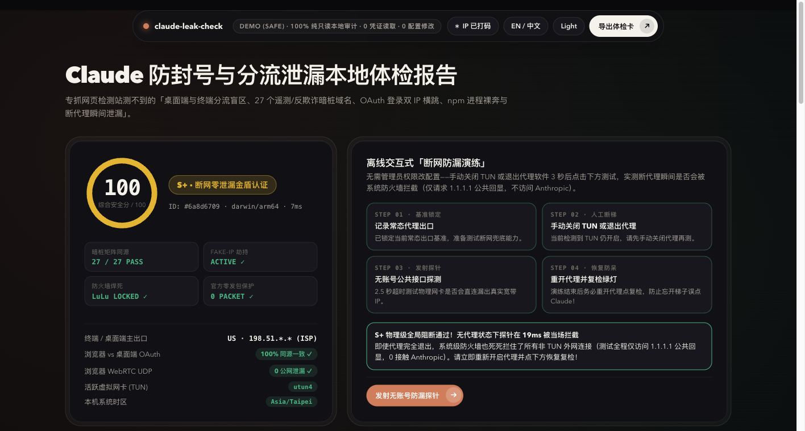
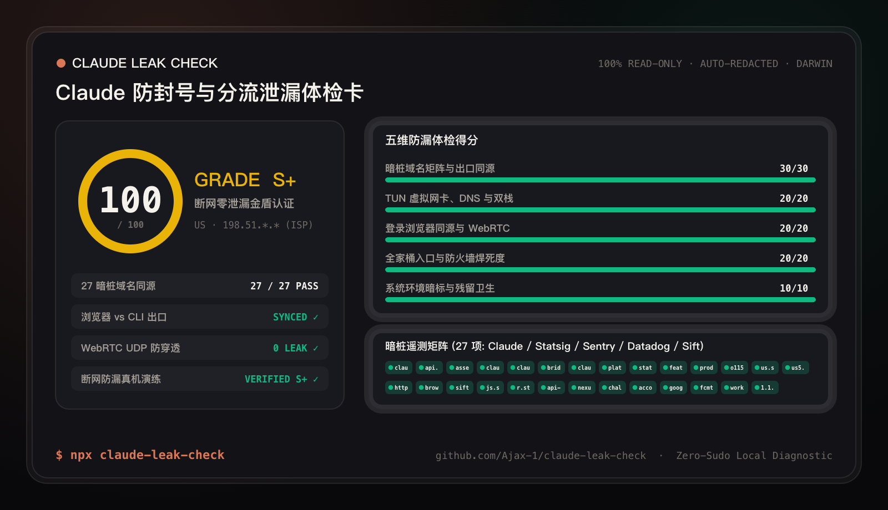

# claude-leak-check

本地只读的 Claude Desktop / Claude Code 网络分流与防泄漏体检工具（目前完整支持 macOS，Windows 提供基础网络与环境检查）。

全程**纯只读、不需要 `sudo` 权限、零第三方运行时依赖、不读取任何账号凭证或代理节点密码**，跑完自动在浏览器打开本地离线报告页，真实 IP 默认打码，方便留存或发图交流。





## 为什么网页 IP 检测站全绿还会翻车？

很多人用 `ippure`、`ipleak` 这类网页工具测出来是满分家宽，用几天还是被封，原因很简单：**网页被关在浏览器沙盒里，它只能看到当前这一个标签页的出口**，测不到浏览器外面的几个常见漏点：

1. **终端与后台辅助进程不吃系统代理**：如果只开了 Clash 的「系统代理」没开 TUN 虚拟网卡，浏览器走的是海外节点，但终端里的 `claude` 以及桌面端底层的辅助进程会直接走本地宽带出去。
2. **第三方监控与反欺诈域名漏配直连**：除了 `claude.ai` 和 `api.anthropic.com`，客户端还会请求 `statsig.anthropic.com`、`featuregates.org`、`prodregistryv2.org`、`o1158394.ingest.us.sentry.io`、`us5.datadoghq.com`、`browser-intake-us5-datadoghq.com`（注意它是横杠不是子域名，`*.datadoghq.com` 通配符匹配不到）、`siftscience.com`、`r.stripe.com`、`api-iam.intercom.io` 等二十多个关联地址。这些第三方域名在国内没有被墙，分流规则漏掉任何一个，或者被国内白名单误放行，后台就会一边挂着海外会话一边用国内宽带 IP 上报遥测。
3. **OAuth 授权登录时的双出口错位**：首次登录或重新授权时，桌面端会拉起系统默认浏览器。如果浏览器里开了代理扩展走节点 A，跳回桌面端走 TUN 节点 B（或直连），同一个登录流程一秒内切了两个 IP。
4. **`npm` 版 CLI 的防火墙盲区与隐藏二进制**：通过 `npm install -g` 装的 Claude Code 底层进程名叫 `node`，按应用名拦截的防火墙（如 LuLu）没法单独拦它；另外 `~/Library/Application Support/Claude/claude-code/` 以及 VS Code / Cursor 扩展目录里还会各自带一份独立的原生二进制，只拦 `/Applications/Claude.app` 会漏掉它们。
5. **代理闪退、休眠唤醒与开机抢跑**：只靠 Clash 内部规则防不住 Clash 自己崩溃退出，也防不住重启电脑时 Claude 比 Clash 早启动两秒。没有系统防火墙兜底的话，断梯子那几秒重连就会直接走物理网卡连上 Sentry / Datadog。

## 检查内容

- **27 项关联域名与纯 IP 路由核验**：检查主站、资源桥接域（`assets-proxy` / `bridge`）、Statsig 灰度开关、Sentry / Datadog 遥测、Sift / Stripe / Intercom 以及无域名纯 IP（`1.1.1.1`）是否全部进入 `utun` 虚拟网卡并命中 Fake-IP。
- **默认浏览器 vs 终端出口实时比对 + WebRTC 自检**：本地报告页打开时，自动比对当前浏览器出口与终端底层出口是否同源，并在本地检测 WebRTC STUN 是否穿透暴露真实公网 IP。
- **本机安装入口与防火墙覆盖度审计**：盘点 `Claude.app`（含 4 个 Chromium Helper、`ShipIt` 更新器、`coworkd`）、后台 `claude-code`、IDE 插件二进制及全局 `claude` 来源；无 `sudo` 解析 Objective-See LuLu（含 v4.x `NSKeyedArchiver` 格式）的生效阻断规则与 Fake-IP CIDR 模式配置，并排查 macOS 上容易引发内核死锁卡死 Wi-Fi 的旧版 `user != root` PF 脚本。
- **网络栈与主机环境检查**：排查国内运营商公网 IPv6 双栈抢跑、Tailscale MagicDNS (`100.100.100.100`) / iCloud 专用代理抢 DNS、Clash 策略组自动回落隐患、系统时区（`Asia/Shanghai`）、`~/.claude/settings.json` 中的代理/第三方中转配置以及本地反代进程。
- **交互式断网防漏演练**：在本地页面引导你手动关闭 TUN 或退出代理软件 3 秒，点击按钮向公共回显接口（`1.1.1.1`，不访问 Anthropic）发探针，实测断代理后是否会被防火墙拦截，并在测完后强制提醒恢复代理复检。

## 使用方法

### 1. 命令行直接运行（推荐）

需要本机装有 Node.js `>= 18.18`：

```bash
npx claude-leak-check
```

若克隆仓库在本地运行：

```bash
git clone https://github.com/Ajax-1/claude-leak-check.git
cd claude-leak-check
npm install
npm run build
npm start
```

### 2. 作为 Agent Skill 使用（Claude Code / Codex / Cursor）

仓库根目录内置了标准 `SKILL.md`：

```bash
npx skills add Ajax-1/claude-leak-check
```

也可以直接在终端输出纯文本脱敏报告：

```bash
npx claude-leak-check --markdown
npx claude-leak-check --json
```

### 常用参数

| 参数 | 说明 |
| :--- | :--- |
| `--markdown`, `--md` | 在终端输出脱敏 Markdown 报告并退出 |
| `--json` | 在终端输出脱敏 JSON 报告并退出 |
| `--export <file.html>` | 导出单文件离线静态 HTML 报告 |
| `--no-open` | 启动本地 `127.0.0.1` 报告服务但不自动弹浏览器 |
| `--no-proxy-config` | 跳过本地代理 YAML 静态策略检查 |
| `--demo <safe\|leak>` | 使用内置测试数据预览报告界面，不探测本机网络 |

## 隐私与安全说明

- **零运行时依赖**：`package.json` 的 `dependencies` 为空，全部使用 Node.js 原生内置模块实现，避免第三方包供应链风险。
- **不碰任何敏感配置与凭证**：不读 Cookie、Keychain、聊天记录与任何 API Key / OAuth Token。代理配置静态检查采用行级白名单状态机，遇到 `proxies:`、`proxy-providers:`、`secret:`、`authentication:` 直接整块跳过，节点地址、密码与订阅链接不会进入内存。
- **官方域名默认零发包**：对 Anthropic 官方域名默认仅通过系统本地 DNS 解析、内核路由表（`route -n get`）与分流规则做本地核验，不向官方接口发探测请求。
- **导出图片强制打码**：点击右上角「导出体检卡」生成的 16:9 / 3:4 PNG 图片在画布层强制对公网 IP（如 `198.51.*.*`）和本地路径（`~/...`）做脱敏处理。

## License

MIT
